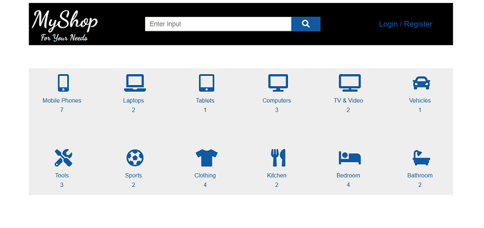
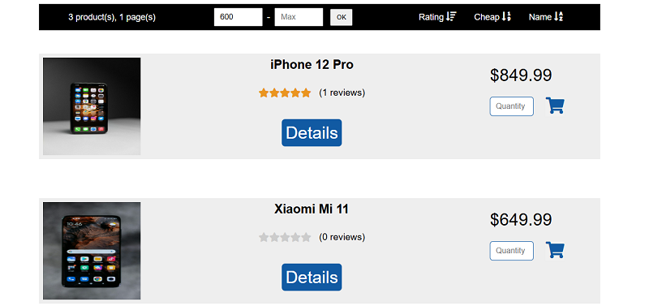
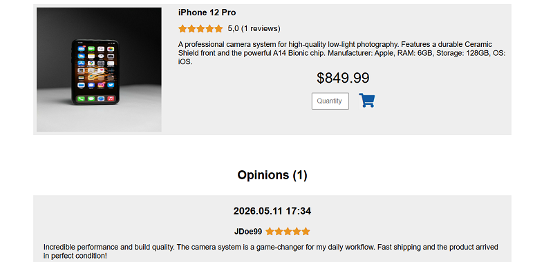
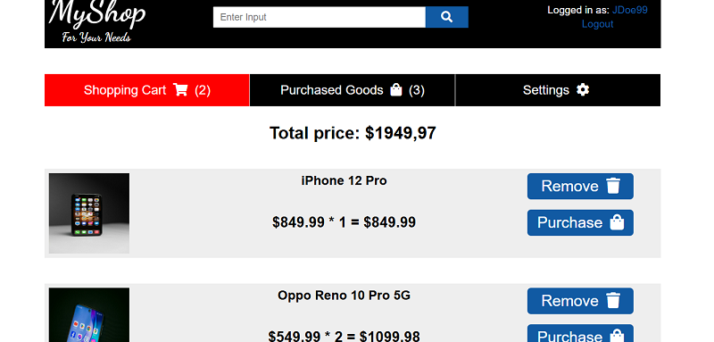
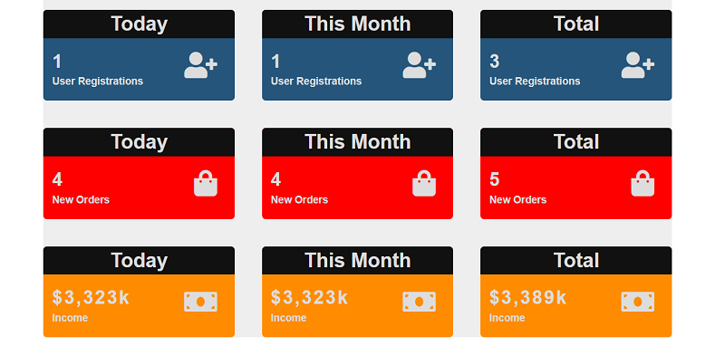

# 🛒 Webshop Application (Spring Boot + Thymeleaf)

This project is a full-stack webshop application built using **Spring Boot** and **Thymeleaf**. It was created to practice backend-driven web development, focusing on authentication, product management, file handling, and user-related purchase flows.

The application simulates a basic e-commerce system where users can browse products, manage a shopping cart, place orders, and interact with account-based features such as email verification and password recovery.

---
## 📄 Table of Contents

* [🛠️ Tech Stack](#tech-stack)
* [💡 Key Features and Preview](#key-features-and-preview)
* [🔎 Technical Implementation Details](#technical-implementation-details)
* [⚙️ Local Setup](#local-setup)

---
## Tech Stack

The application is built using the following core technologies:

| Category | Technologies Used |
| :--- | :--- |
| **Backend** | Java 11, **Spring Boot 2.4**, Spring Security, Spring Data JPA |
| **Database** | **MySQL** |
| **Frontend** | **Thymeleaf**, HTML5, CSS3, JavaScript |
| **Security** | Form-based authentication, BCrypt password encoding |
| **Other** | Spring AOP, Base64 Image Processing, SMTP Integration |

---
## Key Features and Preview

Below are the main functional areas of the application with screenshots from the development environment.

#### 1. Dynamic Category Overview

The homepage displays product categories with dedicated icons and dynamically calculated product counts for each category.


#### 2. Product Listing & Filtering

Users can browse products grouped by category, with filtering options, image previews, pricing, and quick access to detailed product pages. The catalog supports category-based views and sorting to enhance user experience.


#### 3. Product Details & Image Handling

Detailed product page containing descriptions, pricing, and image rendering logic. The application includes a fallback image strategy to ensure stable UI behavior even when uploaded product images are unavailable.


#### 4. Shopping Cart Flow

Authenticated users can manage their cart and place orders. After a successful purchase, customers can leave ratings and reviews to provide feedback on products.


#### 5. Employee Statistics Overview

An internal statistics page displaying application-related metrics and purchase statistics. Leveraged Spring AOP to decouple visitor tracking from core business logic, ensuring clean and maintainable service layers.


---
## Technical Implementation Details

### 1. Authentication & Security

* Authentication handled using Spring Security
* Passwords stored securely using BCrypt
* Role-based authorization for customer and employee-related functionality
* Registration includes an email verification flow for account activation. The verification system was designed to remain demo-friendly, allowing the application to stay fully testable even without fully configured SMTP services
* On application startup, a default employee account is automatically created using **`CommandLineRunner`** if it does not already exist

    * **Default Employee Account:**
        * Username: `Employee`
        * Password: `admin123`

    * ⚠️ For demonstration purposes only.

### 2. Product & File Handling

* Products support image uploads using **`MultipartFile`**
* Uploaded images are converted into **Base64 strings** and stored directly in MySQL.
* Implemented file validation checks:
    * empty file detection
    * invalid filename detection
* File upload size restrictions with user-friendly validation feedback
* Added multiple fallback layers for missing product images:
    * backend-level default image handling
    * frontend-level fallback rendering
* Implemented a customer product rating system tied to purchased items

### 3. Email Functionality

The application integrates email-based account features using **JavaMailSender**:
* Account verification emails
* Forgotten password recovery emails

Special focus was placed on graceful error handling:
* Email delivery failures do not terminate application flow
* Users receive contextual feedback messages instead of server crashes

### 4. Validation & User Feedback

The application uses both frontend and backend validation strategies.

Implemented validation includes:
* Unique username validation
* Unique email validation
* Password confirmation checks
* Form input validation using **`javax.validation`**

Additional UI feedback:
* Conditional success/error messages
* Dynamic forgotten password form behavior using JavaScript

The UI remembers the form's visibility state; if a user submits an invalid email, the backend reloads the page, and the JS logic automatically reopens the form to show the validation error, preventing unnecessary clicks.

### 5. Error Handling

* Custom error pages for:
    * 403 – Access Denied
    * 404 – Page Not Found
    * Generic server-side errors
* Implemented a lightweight custom **`ErrorController`**
* Non-critical exceptions are handled gracefully where possible to preserve user experience

### 6. Entity Relationships & Domain Logic

The application contains several relational mappings using JPA/Hibernate, including:
* Customer ↔ Cart
* Customer ↔ Purchased Items
* Product ↔ Product Details
* Customer ↔ Roles

Validation and relationship handling are implemented using standard JPA annotations and Hibernate validation constraints.

### 7. Administrative Features

The employee-side functionality includes:
* Product upload management
* Order-related statistics
* Basic application metrics

A lightweight AOP-based visitor tracking mechanism was added as an additional backend-focused feature within the application's statistics functionality.

---

## Local Setup

### Prerequisites

* Java 11 or higher
* Maven
* MySQL server

### 1. Database

1.  Create a database named **`webshop_db`**.
2.  Configure your credentials in **`src/main/resources/application.properties`**:

For reference, the required configuration block looks like this:

```properties
spring.datasource.url=jdbc:mysql://localhost:3306/webshop_db?useSSL=false&serverTimezone=UTC
spring.datasource.username=your_username
spring.datasource.password=your_password

# Hibernate properties
spring.jpa.hibernate.ddl-auto=update
```
### 2. Email Configuration

To enable the registration and password reset features, provide your SMTP credentials:

```properties
spring.mail.host=smtp.gmail.com
spring.mail.username=your_email@gmail.com
spring.mail.password=your_password
```

### 3. Running the Application

1. Navigate to the backend directory.
2. Run the application using Maven: **`./mvnw spring-boot:run`**
3. Alternatively, you can run the application directly from your IDE (recommended for development).

The application will start on port **8080**.

